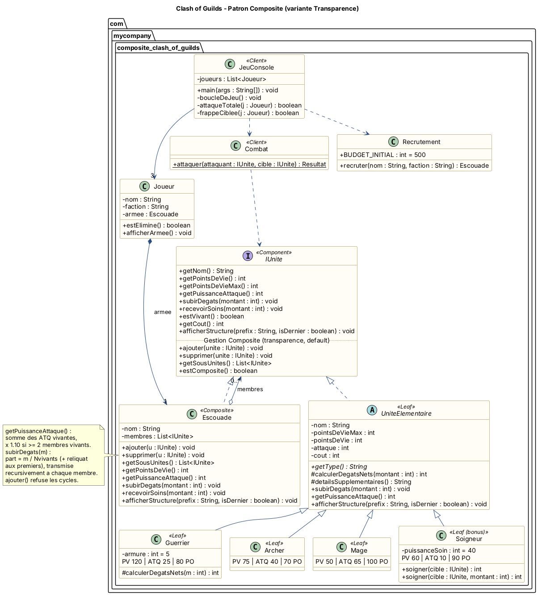
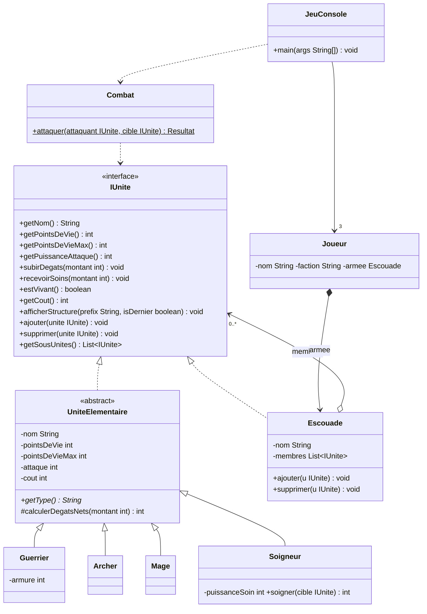

# Clash of Guilds — TP Patron Composite (Java)

Wargame tactique au tour par tour pour **3 joueurs**, en console, illustrant le patron de
conception **Composite** (GoF). Chaque guilde est un arbre d'unités :
Armée → Bataillons → Escouades → Soldats (Guerrier, Archer, Mage, Soigneur).

- Code source : [`src/main/java/com/mycompany/composite_clash_of_guilds`](src/main/java/com/mycompany/composite_clash_of_guilds)
- Diagramme de classes : [`docs/diagramme_classes.png`](docs/diagramme_classes.png) (source PlantUML : [`docs/diagramme_classes.puml`](docs/diagramme_classes.puml))
- Compte-rendu + réponses aux questions Q1–Q4 : [`docs/COMPTE_RENDU.md`](docs/COMPTE_RENDU.md)

## Lancer le jeu dans VS Code

1. Installer un **JDK 17 ou plus** et l'extension **Extension Pack for Java**
   (`vscjava.vscode-java-pack`, proposée automatiquement à l'ouverture du dossier).
2. `Fichier > Ouvrir le dossier...` → choisir le dossier `clash_of_guilds`.
3. Attendre que VS Code importe le projet (Maven, `pom.xml`).
4. Onglet **Exécuter et déboguer** (Ctrl+Shift+D) → choisir **« Jouer a Clash of Guilds »** → ▶.
   Le jeu s'ouvre dans le terminal intégré (indispensable pour taper les choix).
   - Ou ouvrir `JeuConsole.java` et cliquer sur **Run** au-dessus de `main`.
   - La configuration **« Tests Clash of Guilds »** lance les 27 vérifications des règles.

### Sans VS Code (terminal)

```bash
./run.sh                      # Linux / macOS
run.bat                       # Windows
./run.sh TestsClashOfGuilds   # tests des regles
# ou avec Maven :
mvn package && java -jar target/composite_clash_of_guilds-1.0.jar
```

## Règles du jeu

| Unité | PV | ATQ | Armure | Coût | Particularité |
|---|---|---|---|---|---|
| Guerrier | 120 | 25 | 5 | 80 PO | dégâts nets = max(1, dégâts − 5) |
| Archer | 75 | 40 | – | 70 PO | encaisse tous les dégâts |
| Mage | 50 | 65 | – | 100 PO | canon de verre |
| Soigneur *(bonus)* | 60 | 10 | – | 90 PO | soigne son escouade de 40 PV |

- **Attaque d'un groupe** = somme des attaques des membres vivants, **+10 %** si au moins 2 membres vivants (bonus de synergie, cumulé à chaque niveau).
- **Dégâts reçus par un groupe** : répartis équitablement entre les membres vivants, récursivement (le reliquat va aux premiers).
- À chaque tour : *Inspecter* son armée / les ennemis, **Attaque Totale**, **Frappe Ciblée** (une sous-escouade frappe un point précis de l'armée ennemie) ou **Soigner**.
- Une guilde dont toutes les unités sont à 0 PV est anéantie ; la dernière guilde en lice gagne.
- Au lancement : armées **prédéfinies** ou **recrutement budgété** (500 PO par joueur).

## Diagramme de classes





## Structure du code

| Fichier | Rôle |
|---|---|
| `IUnite.java` | **Composant** : interface commune (transparence : `ajouter/supprimer` en `default`) |
| `UniteElementaire.java` | Base abstraite des **feuilles** |
| `Guerrier.java`, `Archer.java`, `Mage.java`, `Soigneur.java` | **Feuilles** |
| `Escouade.java` | **Composite** : calculs récursifs, répartition des dégâts, protection anti-cycles |
| `Combat.java` | Moteur de combat (logique pure, ne connaît que `IUnite`) |
| `Joueur.java` | Joueur, faction, armée racine |
| `JeuConsole.java` | **Client** : `main`, boucle de jeu à 3 joueurs, menus |
| `GuildesPredefinies.java` | Les 3 armées de départ |
| `Recrutement.java` | Bonus : phase de recrutement avec 500 PO |
| `ParcoursArbre.java`, `Saisie.java` | Outils console (parcours pour menus, saisies contrôlées) |
| `TestsClashOfGuilds.java` | Vérifications automatiques des règles |
